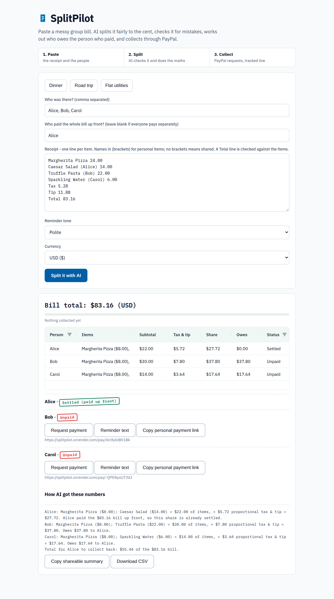

# SplitPilot (v4)

**An AI agent that turns a messy group bill into fair shares, settles who owes the person who paid, and collects through PayPal.**



New in v3: the results table is an **AG Grid** data grid (sortable,
filterable), every debtor gets a **personal payment-link page**, the
split **persists to disk** across server restarts, bills can be split
in **USD / CAD / EUR / GBP** (the chosen currency flows into the PayPal
order), and GitHub Actions runs the test suite on every push.

v4 is a full visual redesign, built with the `frontend-design` and
`ui-ux-pro-max` skills: the direction is the printed receipt treated
seriously - flat, no shadows or gradients, IBM Plex Sans with IBM Plex
Mono for every number, and colour that only ever means money state
(PayPal blue = act, green = settled, red = owed), with paid and unpaid
shown as rotated rubber-stamp badges. The design tokens live in a
comment at the top of the stylesheet in `app.py`.

Built for the PayPal AI Hackathon 2026 (Devpost). Deadline: **Nov 12, 2026, 3:00 PM EST**.

## The problem

Splitting a group bill is a small task that goes wrong constantly: shared
dishes, personal items, tax and tip, rounding, and then the awkward
"can you send me the $17.64?" message. Existing tools do the arithmetic
but stop before the money actually moves, and none of them check the
bill itself for mistakes.

## What SplitPilot does

1. **Paste the receipt** (one line per item; put names in brackets for
   personal items, leave them off for shared ones) and list who was
   there. Price-first lines, quantities (`Coffee x2`), and a receipt
   `Total` line are all understood. Three one-click presets (dinner,
   road trip, flat utilities) are built in for demos.
2. **AI parsing and fairness engine** extracts items and people, treats
   unnamed items as shared, allocates tax and tip proportionally, and
   reconciles rounding so the shares sum exactly to the bill total.
3. **AI anomaly check** flags duplicate-looking charges, unreadable
   lines, and a declared total that does not match the parsed items,
   with a plain-language explanation, before any money moves.
4. **Settlement**: say who paid the whole bill up front. Everyone else's
   share becomes an amount owed to that payer, and the payer's own share
   is settled automatically. A per-person explanation shows exactly how
   every number was produced.
5. **PayPal collection**: each amount owed becomes a real PayPal order
   via the Orders v2 API in the Sandbox environment (create, approval
   link, capture). A live collection bar tracks what has been collected.
6. **Personal payment links**: each debtor gets an unguessable link
   (`/pay/<token>`) showing only their own items, breakdown, and a
   PayPal pay button, so the organiser can drop one link per person
   into the group chat instead of chasing everyone in one thread.
7. **Reminder agent and export**: the follow-up message is drafted in a
   polite, firm, or funny tone from the person's actual items, and the
   final split can be copied as a group-chat summary or downloaded as
   CSV.
8. **Built to survive a demo**: the results render in an AG Grid data
   grid (with a plain-table fallback if the CDN is unreachable), and
   the current split is saved to `data/state.json` on every change, so
   a server restart never loses a collection in progress. The data
   file location can be changed with `SPLITPILOT_DATA`.

## Run it

No dependencies. Python 3.10+ standard library only.

```bash
python3 app.py            # http://localhost:8000
python3 tests/test_split.py
```

### Turn on live PayPal Sandbox orders (5 minutes)

1. Create a free account at https://developer.paypal.com and a Sandbox app.
2. Copy its Client ID and Secret, then:

```bash
export PAYPAL_CLIENT_ID="..."
export PAYPAL_CLIENT_SECRET="..."
python3 app.py
```

With credentials set, "Request payment" creates a real Sandbox order and
shows the PayPal approval link, and "Capture payment" completes it
through the API. Without them, the app runs in a clearly
labelled Sandbox Demo Mode that builds the identical order payload and
simulates approval and capture, so the flow can be evaluated offline.

### Hosted demo (optional)

`render.yaml` is included: on Render, create a Web Service from the
repo and it deploys with no build step. Set the same two PayPal env
vars in the Render dashboard for live Sandbox orders.

## Tools used

- **PayPal Developer Platform**: Orders v2 API, Sandbox environment,
  OAuth client-credentials flow (`app.py`, `create_order`).
- **AG Grid** (Community, via CDN): the results grid - sortable and
  filterable columns for person, items, subtotal, tax & tip, share,
  amount owed, and status, with currency-aware formatting.
- **AI**: a deterministic natural-language receipt parser, a proportional
  fair-split engine with cent-exact reconciliation, an anomaly detector,
  and a tone-aware reminder generator. All run locally with no key, so
  judges can run the demo anywhere. An optional hosted-LLM hook can be
  layered on the same parsing interface for free-form receipt photos and
  paragraphs; the rule-based parser remains the fallback.
- **Stack**: Python 3 standard library only (no build step, no pip).

## Project layout

- `app.py` - server, parser, split engine, PayPal client, UI (single file)
- `tests/test_split.py` - parser and split-math tests (all passing)
- `SUBMISSION.md` - the Devpost submission text
- `DEMO_SCRIPT.md` - shot-by-shot script for the under-3-minute demo video

## License

MIT, see `LICENSE`.
